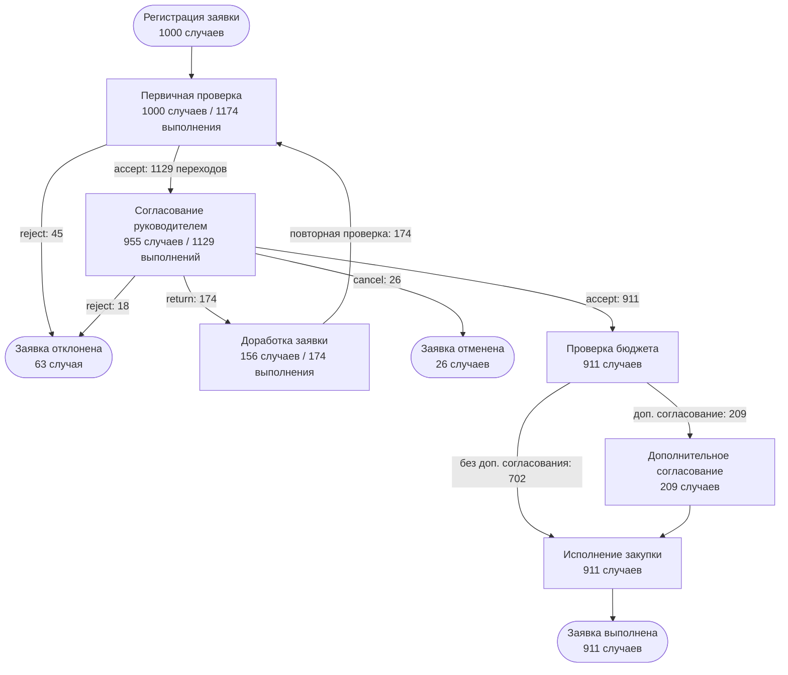

# Кейс 2. Восстановление процесса по журналу событий

## Схема восстановленного процесса



## Легенда

- Прямоугольник - наблюдаемая человеческая активность.
- Скруглённый узел - начало или наблюдаемое завершение истории.
- Подпись на стрелке - результат действия или число наблюдаемых непосредственных переходов.
- Возврат руководителя образует цикл `Согласование руководителем → Доработка заявки → Первичная проверка`.
- Развилка после проверки бюджета наблюдается во всех успешных историях. Для заявок без дополнительного согласования максимальная сумма равна 149 743,41; с дополнительным согласованием минимальная сумма равна 150 614,59. Порог 150 000 согласуется со всеми данными, но остаётся гипотезой о внутреннем правиле.

Схема описывает множество наблюдаемых историй. Она не утверждает, что платформа технически реализована именно такими шлюзами или что цикл допускает любое число повторений.


## 1. Метод и проверка данных

Анализ выполнен скриптом `analyze_case2.py` на Python с `pandas`. Для воспроизведения из папки кейса достаточно выполнить:

```powershell
python .\analyze_case2.py
```

Строки сгруппированы по `ProcessInstanceId` и внутри каждого экземпляра отсортированы по числовому `EventIndex`. Полная последовательность `ActivityName` стала ключом варианта. Непосредственные пары соседних действий использованы для графа переходов. Результаты действий анализировались отдельно, потому что одинаковая активность руководителя поддерживает accept, return, reject и cancel.

Журнал содержит 6508 событий и 1000 завершённых экземпляров. Проверка качества не выявила повторов `EventId`, повторов индексов внутри экземпляра, пропусков `EventIndex`, обратного хода времени, изменений суммы или версии шаблона. Каждая история начинается регистрацией и завершается ровно одним из трёх конечных событий. Поэтому отсутствие этапа в конкретной истории связано с маршрутом, а не с незавершённой выгрузкой.

## 2. Активности, начало и окончания

Обнаружено десять названий действий с учётом границ процесса. `Регистрация заявки` встречается в начале всех 1000 историй. `Первичная проверка` также присутствует во всех историях, но выполнена 1174 раза из-за возвратов. `Согласование руководителем` встречается в 955 случаях, `Проверка бюджета` и `Исполнение закупки` - в 911 успешных случаях. `Дополнительное согласование` появляется в 209 случаях.

Конечные состояния взаимоисключающие: 911 заявок выполнены, 63 отклонены и 26 отменены. Из 63 отказов 45 произошли после первичной проверки, ещё 18 - после решения руководителя. Отмена наблюдается только как результат решения руководителя.

## 3. Основной маршрут и развилки

Основной маршрут: **Регистрация → Первичная проверка → Руководитель → Бюджет → Исполнение → Выполнено**. Он охватывает 567 случаев (56,7%). После первичной проверки наблюдаются две ветви: accept ведёт к руководителю, reject в 45 случаях сразу завершает заявку отказом.

После согласования руководителем наблюдаются четыре результата:

- accept - 911 переходов к проверке бюджета;
- return - 174 перехода к доработке;
- reject - 18 завершений отказом;
- cancel - 26 завершений отменой.

После бюджета есть наблюдаемая необязательная активность. В 702 успешных случаях исполнение началось сразу, в 209 сначала выполнено дополнительное согласование. Сумма полностью разделяет эти ветви: максимум без дополнительного согласования - 149 743,41, минимум с ним - 150 614,59. Поэтому правило `Amount > 150 000` является сильной гипотезой: оно верно для всех 911 успешных историй. Однако точное внутреннее значение порога не наблюдается; данные непосредственно доказывают только границу между 149 743,41 и 150 614,59.

## 4. Возвраты и повторные выполнения

Руководитель вернул 156 уникальных заявок. В 138 из них цикл выполнен один раз, в 18 - два раза. Всего наблюдается 174 перехода `Руководитель → Доработка`, 174 доработки и 174 повторных первичных проверки. После последнего повторного согласования все эти истории продолжились через бюджет и завершились выполнением. В данных нет возврата от бюджета или дополнительного согласования.

Схема показывает цикл, но не доказывает, что система разрешает неограниченное число повторений. Наблюдаемый максимум - два возврата в одном экземпляре.

## 5. Полные варианты

Получено восемь полных вариантов, вместе покрывающих 100% журнала:

- **V1: 567 случаев (56.7%)** - `Регистрация заявки > Первичная проверка > Согласование руководителем > Проверка бюджета > Исполнение закупки > Заявка выполнена`. Пример: `00f3e3a0-9d7d-5eac-98a9-b605b6893e61`.
- **V2: 188 случаев (18.8%)** - `Регистрация заявки > Первичная проверка > Согласование руководителем > Проверка бюджета > Дополнительное согласование > Исполнение закупки > Заявка выполнена`. Пример: `01ae1813-1d99-5524-8f81-77ad5452c33e`.
- **V3: 117 случаев (11.7%)** - `Регистрация заявки > Первичная проверка > Согласование руководителем > Доработка заявки > Первичная проверка > Согласование руководителем > Проверка бюджета > Исполнение закупки > Заявка выполнена`. Пример: `015bf5dd-d3b4-5b89-8814-7ca369f74e92`.
- **V4: 45 случаев (4.5%)** - `Регистрация заявки > Первичная проверка > Заявка отклонена`. Пример: `08a60c66-22dd-5cf8-90dd-71ba3d53f349`.
- **V5: 26 случаев (2.6%)** - `Регистрация заявки > Первичная проверка > Согласование руководителем > Заявка отменена`. Пример: `00e3854b-efb6-59c7-ac6a-c85643843db1`.
- **V6: 21 случаев (2.1%)** - `Регистрация заявки > Первичная проверка > Согласование руководителем > Доработка заявки > Первичная проверка > Согласование руководителем > Проверка бюджета > Дополнительное согласование > Исполнение закупки > Заявка выполнена`. Пример: `055f6c87-61a2-52aa-86ec-940480c96dcd`.
- **V7: 18 случаев (1.8%)** - `Регистрация заявки > Первичная проверка > Согласование руководителем > Доработка заявки > Первичная проверка > Согласование руководителем > Доработка заявки > Первичная проверка > Согласование руководителем > Проверка бюджета > Исполнение закупки > Заявка выполнена`. Пример: `009608ae-1567-584a-b67a-c7ec60ec587d`.
- **V8: 18 случаев (1.8%)** - `Регистрация заявки > Первичная проверка > Согласование руководителем > Заявка отклонена`. Пример: `02bf4e3d-60b1-5713-9886-43fa49c67001`.

Два первых варианта дают 75,5% историй, а три наиболее частых - 87,2%. Самые редкие наблюдаемые варианты имеют по 18 случаев (1,8%), но редкость не трактуется как ошибка.

## 6. Непосредственные переходы

В журнале обнаружено 12 уникальных пар соседних действий:

- `Первичная проверка → Согласование руководителем` - 1129 переходов.
- `Регистрация заявки → Первичная проверка` - 1000 переходов.
- `Исполнение закупки → Заявка выполнена` - 911 переходов.
- `Согласование руководителем → Проверка бюджета` - 911 переходов.
- `Проверка бюджета → Исполнение закупки` - 702 переходов.
- `Дополнительное согласование → Исполнение закупки` - 209 переходов.
- `Проверка бюджета → Дополнительное согласование` - 209 переходов.
- `Доработка заявки → Первичная проверка` - 174 переходов.
- `Согласование руководителем → Доработка заявки` - 174 переходов.
- `Первичная проверка → Заявка отклонена` - 45 переходов.
- `Согласование руководителем → Заявка отменена` - 26 переходов.
- `Согласование руководителем → Заявка отклонена` - 18 переходов.

CSV `student_transitions.csv` содержит эти пары без частот, как требует шаблон. Частоты приведены здесь как доказательство структуры.

## 7. Автоматическая и ручная модели

Автоматический directly-follows graph корректно восстанавливает все наблюдаемые пары и хорошо показывает цикл возврата. Ручная схема добавляет смысл результатов, конечные состояния и условную ветвь по сумме. Простой граф непосредственного следования допускает больше поведения, чем журнал: произвольное число циклов, сочетание переходов без учёта результата и ветвление после бюджета без условия суммы. Поэтому он полезен как проверка полноты переходов, но не заменяет модель вариантов.

## 8. Ограничения и роль AI

Журнал доказывает только наблюдавшиеся последовательности. Он не раскрывает тип шлюзов, параллельность, скрытые автоматические действия и все разрешённые системой маршруты. Отсутствие перехода означает лишь, что он не встретился в 1000 историях. Временные интервалы не использовались для вывода структуры, поскольку включают ожидание и нерабочее время.

AI использовался для формулирования гипотез, подготовки читаемой Mermaid-схемы и текста отчёта. Все маршруты, доли, переходы, результаты и примеры рассчитаны программно. Проверка включает сумму вариантов 1000, сумму долей 1, совпадение переходов схемы с `student_transitions.csv` и повторное построение файлов из исходного CSV.
